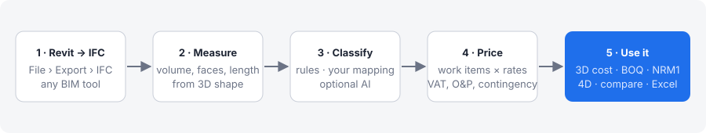
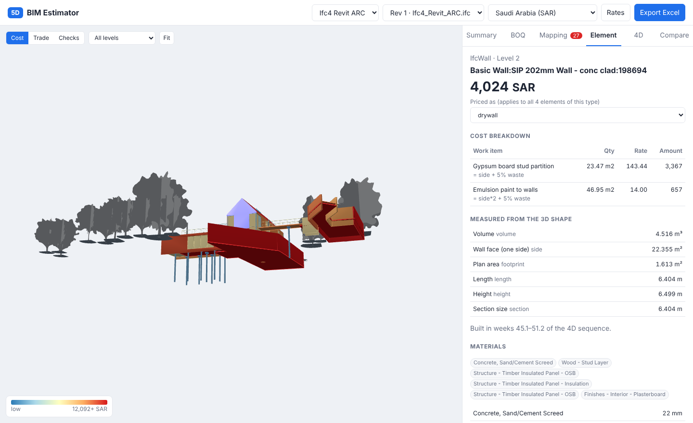
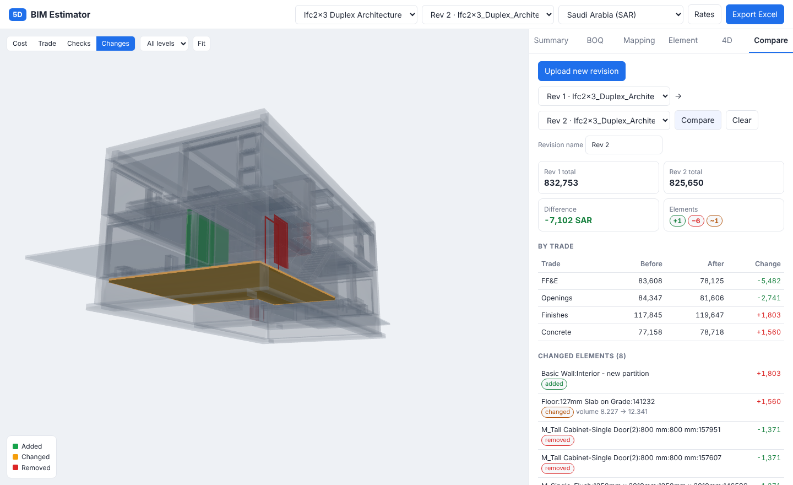
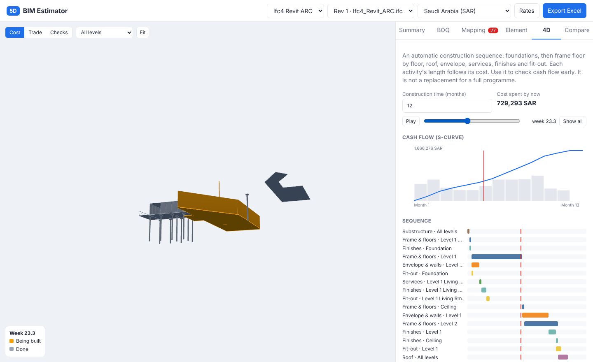
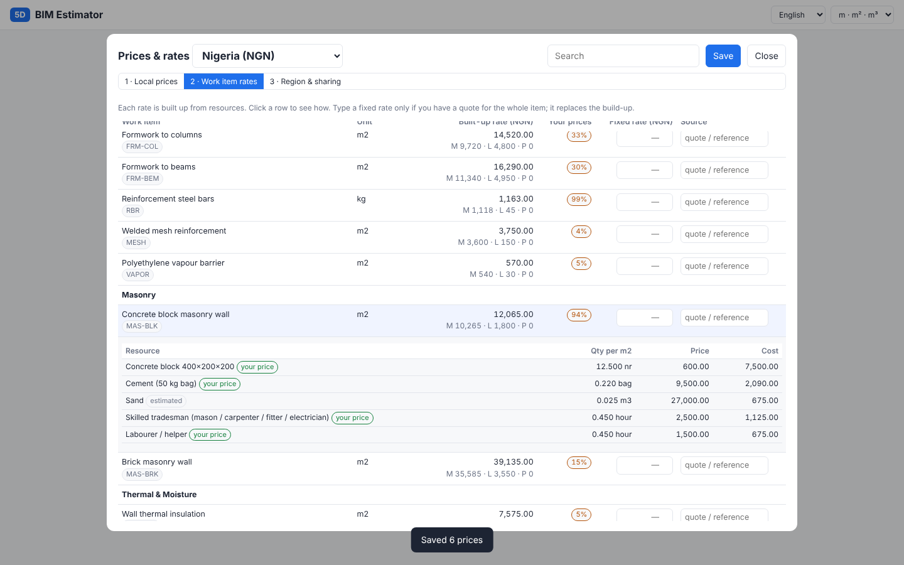
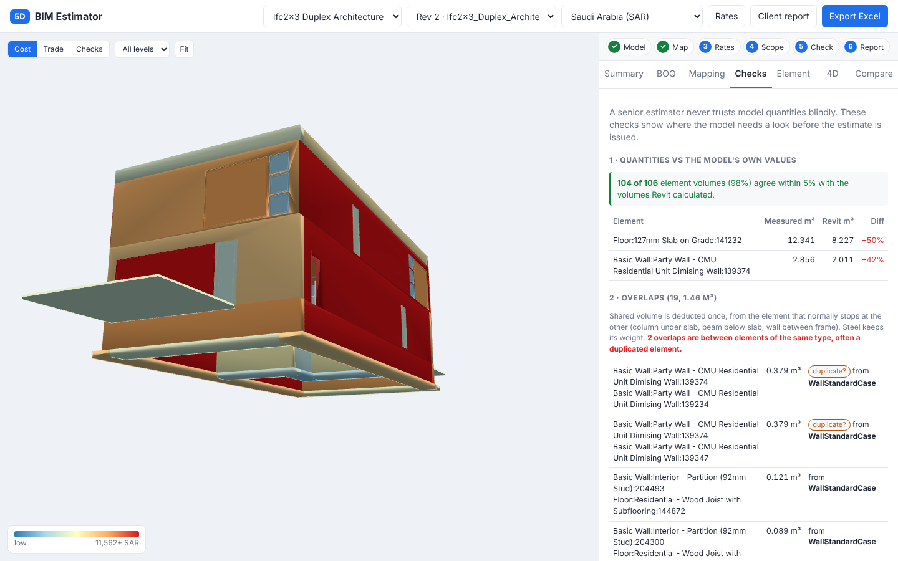
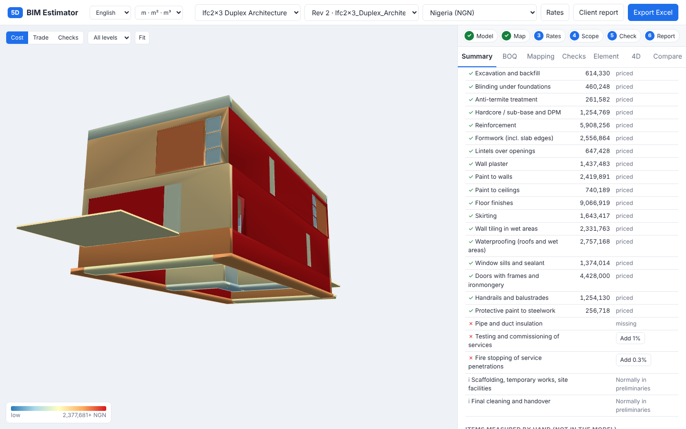

# BIM 5D Estimator

**Free and open source 5D BIM for everyone.** Upload a Revit model (exported as IFC) and get a priced
estimate of every element, shown on the 3D model, in any country, any currency, five languages.
No licence fees, no account, works offline on your own computer.



| Element cost with formulas | Revision comparison | 4D sequence and cash flow |
|---|---|---|
|  |  |  |
| **Prices & rates (rate builder)** | **Accuracy checks** | **Summary, scope and checklist** |
|  |  |  |

## Start in 2 minutes

**Windows:** install [Python 3.10+](https://www.python.org/downloads/) (tick *Add python.exe to PATH*),
unzip, double-click **`start-windows.bat`**.
**Mac / Linux:** `bash start-mac-linux.sh`.
**Docker:** `docker compose up --build`.

The browser opens at http://localhost:8000. Pick your region, drop an IFC file or try a sample.
To share it with others for free (own computers, a free website, GitHub), see
[docs/SHARE_FOR_FREE.md](docs/SHARE_FOR_FREE.md).

## Works in any country: the rate builder

Nobody publishes a free, up-to-date, worldwide price list, so the tool does what estimators do:
**rate analysis**. Every work item is broken into resources (labour hours, materials, plant) with
editable norms, for example 1 m² of 200 mm blockwork = 12.5 blocks + 0.22 bag cement + 0.025 m³ sand
+ 0.45 h mason + 0.45 h labourer.

1. **Prices & rates → Region & sharing → Add your country** (244 countries with currency and VAT).
2. Optional: **Update from World Bank** fills the exchange rate and price level (free data, needs internet).
3. **Local prices**: type what ~20 key things cost where you work (wages, ready-mix, cement, rebar,
   blocks…). Every rate is rebuilt from them; the share coming from *your* prices is shown per item.
4. Share your prices as a **rate pack** file so colleagues (or the whole community) can start from them.

Have quotes for whole items? Type a **fixed rate** and it replaces the build-up.

## What it does

| | |
|---|---|
| **Measures every element** from its 3D shape (volume, wall face, plan area, length, pipe size) and repairs badly exported shapes. 98–100% of element volumes agree within 5% with Revit's own values on the samples. |
| **Rooms → finishes**: floor finish, skirting (perimeter minus doors), wall paint or tiles (perimeter × height minus openings), ceiling paint, wet-area waterproofing, by room type (bathroom, kitchen, plant room, balcony…). No double counting with modelled ceilings/floors or with wall finishes. |
| **Derived quantities nobody should forget**: excavation, blinding, backfill, hardcore, anti-termite, DPM, slab edge formwork, roof upstands, lintels, window sills, sealant, reveals, external render and paint (external walls), steel paint, pipe and duct insulation. |
| **Missing-items checklist** shows what is priced, covered by an allowance, or missing, with one-click allowances. **Manual items** (virtual takeoff) for anything not in the model. |
| **Measurement standards**: NRM2, POMI, IS 1200 (India: one-face deduction for 0.5–3 m² openings) or exact net. |
| **Overlaps**: exact 3D intersection (column through slab, beam in slab, wall through column) deducted once, following measurement practice; duplicates flagged. |
| **Classifies** elements with editable rules (IFC class + keywords, Uniformat codes, system types; English, German and Arabic keywords). Architecture, structure, MEP; IFC2x3 and IFC4. **Mapping screen** + optional AI suggestions for unknown types. |
| **Estimate**: BOQ by trade, NRM1 and Uniformat cost plans, cost per m² with benchmark, preliminaries, contingency, OH&P, escalation, VAT/GST, accuracy class and range (AACE guidance) with reasons. |
| **4D** sequence with 3D playback and S-curve cash flow; **revision comparison**; **client report** (PDF); **Excel** workbook with formulas; **audit trail**. |
| **Languages**: English, العربية, اردو, Español, Français (right-to-left supported). **Units**: metric or imperial display. |

## How it works

```
Revit ─IFC─▶ extract.py ──▶ estimate.py ─────────────────────────▶ web app / Excel / report
             geometry,       rules.csv → recipe (element or room)
             rooms,          recipes.csv → work items + formulas (incl. derived quantities)
             openings,       norms.csv × resource prices → rates (rate builder)
             overlaps        regions.json: currency, tax, factors, standard
```

| Folder / file | Purpose |
|---|---|
| `engine/extract.py` | IfcOpenShell reading, robust measurement, rooms (IfcSpace) with doors/windows, openings, host walls. |
| `engine/estimate.py` | Classification, safe formulas, measurement standards, overlaps, rate builder, pricing, checklist, accuracy. |
| `engine/regions.py` | Countries, regions, local prices, World Bank update, rate packs. |
| `engine/overlaps.py` | Exact 3D overlap volumes (manifold3d). |
| `engine/storage.py`, `schedule.py`, `compare.py`, `rates.py`, `export.py`, `ai.py` | Projects, 4D, revisions, fixed rates, Excel, AI. |
| `server.py` | FastAPI app and REST API. `web/` | Browser app (three.js bundled, no build step, no Node.js). |
| `data/` | **Everything that decides the price; plain CSV/JSON you can edit in Excel.** |

| Data file | What it holds |
|---|---|
| `work_items.csv` | Work items: code, description, unit, trade, MasterFormat. |
| `resources.csv` | Labour, materials, plant with USD base prices and which are "key" prices. |
| `norms.csv` | Resource quantities per unit of each work item (the rate analysis). |
| `rules.csv` | Which recipe an element or room gets (priority, IFC class, keyword regex). |
| `recipes.csv` | How one element becomes work items (quantity formulas). |
| `recipe_groups.csv` | Friendly name, NRM1, Uniformat, 4D stage of each recipe. |
| `regions.json` | Region settings (currency, exchange rate, factors, tax, mark-ups, standard). |
| `prices/<REGION>.csv` | Your local resource prices. `rates/<REGION>.csv`: fixed item rates. |
| `countries.json` | 244 countries with currency (Unicode CLDR). |

**Formula variables** — elements: `volume area side footprint length width height perimeter surface
section count`, rule-measured faces `side_m finish1 finish2`, flags `ext rooms_on host_masonry host_t
insulated`, door/window `ow oh`; rooms: `floor_area perimeter height wall_area skirting has_floor
has_ceiling`. Functions `t("regex")` (layer thickness) and `has("regex")`; comparisons give 1/0.

> Norms and base prices are typical starting values, not quotations. The accuracy class stays at
> Class 5 until most of the cost comes from **your** prices.

Run the tests: `python -m pytest -q`. Optional AI suggestions: set `ANTHROPIC_API_KEY`.

## Limits to know

- The estimate is only as complete as the model; use rooms, the checklist, allowances and manual items for the rest.
- Rebar by ratio is an allowance until bar schedules or modelled rebar are used.
- The 4D sequence is automatic; it does not replace a real programme.
- Engine-generated text (work item names, checklist) is English for now; the interface is translated.

## Roadmap

1. Revit add-in (pyRevit / C#) for one-click export and cost write-back.
2. Community rate packs per country and city, with dates and sources.
3. Primavera P6 / MS Project import for real 4D.
4. Translated work-item descriptions and BOQ in each language.
5. Users, roles and approvals for teams.

See [docs/USER_GUIDE.md](docs/USER_GUIDE.md), [docs/RESEARCH.md](docs/RESEARCH.md) and
[docs/SHARE_FOR_FREE.md](docs/SHARE_FOR_FREE.md).

## Licence

Code: MIT. Data in `data/`: CC0 (public domain). See [LICENSE](LICENSE) for third-party notes.
