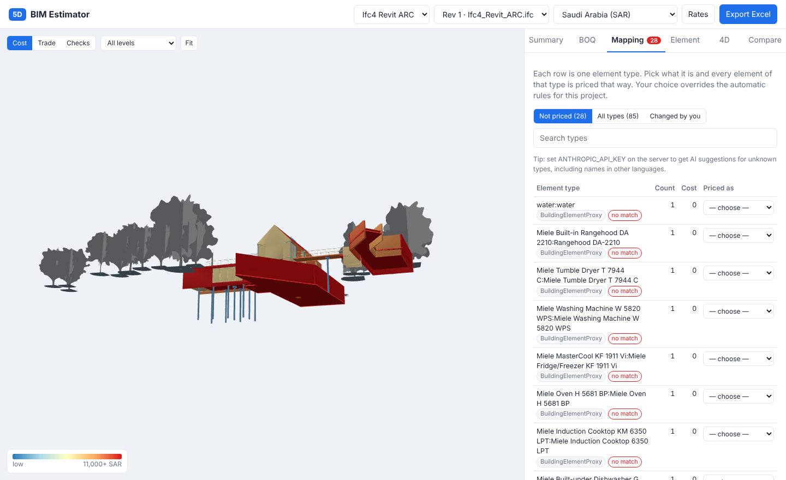

# BIM 5D Estimator

Open-source, web-based 5D BIM: upload a Revit model (exported as IFC) and get a priced
estimate of every element, shown on the 3D model. Works for any country; Saudi Arabia is
set up as the default region.


| Element cost with formulas | Revision comparison | 4D sequence and cash flow |
|---|---|---|
|  |  |  |
| **Mapping unknown types** | **Rates editor** | |
|  |  | |

## What it does

| | |
|---|---|
| **Measures every element** from its 3D shape (volume, wall face, plan area, length, pipe size), so it does not depend on Revit quantity sets, which are often missing or wrong. |
| **Classifies** elements with editable rules (IFC class + keywords in name, type, materials, Uniformat / assembly code, system type). Works for architecture, structure and MEP, IFC2x3 and IFC4. |
| **Breaks elements into work items** with formulas, e.g. concrete slab → concrete (only the concrete layer), formwork, rebar, screed, insulation. |
| **Prices** with regional rates: base library in USD + your local rates (SAR, AED, PKR, …), contingency, overhead, profit and VAT/GST. |
| **Mapping screen**: pick what any unknown element type is; every element of that type follows. Optional AI suggestions for unknown types (any language). |
| **Rates editor** in the browser, Excel import/export. |
| **Elemental cost plan** by NRM1 and Uniformat, BOQ by trade, cost by level, cost per m² with a benchmark check. |
| **4D**: automatic construction sequence (substructure → frame floor by floor → roof → envelope → services → finishes), 3D playback, S-curve cash flow. |
| **Revision comparison**: upload a new export, see added / removed / changed elements and the cost difference by trade. |
| **Rebar**: from ratios or from modelled bars, with a check showing both. |
| **Accuracy checks like a senior estimator**: exact 3D overlap deduction (no double counting), NRM2 opening rule, reconciliation with Revit's own volumes (98–100% within 5% on the samples), duplicate detection, repair of badly exported shapes. |
| **Scope and allowances**: shows which parts of the building are missing from the model and adds suggested allowances; preliminaries, contingency, OH&P, escalation, VAT. |
| **Accuracy class and range** (AACE 18R-97 guidance) with the reasons and what to fix to narrow it. |
| **Client report** (print / PDF) with assumptions and exclusions; **audit trail** of every change; quantity adjustments only with a written reason. |
| **Transparency**: every cost line shows its formula, waste and rate source. |
| **Excel export**: Summary, NRM1, Uniformat, BOQ, element costs, mapping, programme, cash flow with S-curve chart, model checks. |

## Run it

```bash
pip install -r requirements.txt
cd web && npm install && cd ..
uvicorn server:app --port 8000
```

Open http://localhost:8000 and drop an IFC file, or choose a sample.

With Docker:

```bash
docker compose up --build
```

Optional AI suggestions: set `ANTHROPIC_API_KEY` before starting the server.

Run the tests:

```bash
python -m pytest -q
```

## How it works

```
Revit ─IFC─▶ extract.py ─▶ estimate.py ─────────────────────▶ web app (3D + panels)
             geometry      rules.csv → recipe                    Excel export
             quantities    recipes.csv → work items + formulas   compare.py (revisions)
             materials     rates/ + regions.json → prices         schedule.py (4D, cash flow)
             layers        project mappings override rules
```

| Folder / file | Purpose |
|---|---|
| `engine/extract.py` | Reads IFC with IfcOpenShell, measures each element in its local axes with numpy, keeps materials, layer thicknesses, classification, key Revit properties, level elevation. Flags shapes that are not closed solids. |
| `engine/estimate.py` | Classification, safe formula evaluator, pricing, BOQ, elemental groups, summary. |
| `engine/storage.py` | Projects and revisions on disk (SQLite + compressed files), background processing. |
| `engine/schedule.py` | Automatic 4D sequence and monthly cash flow. |
| `engine/compare.py` | Revision comparison by IFC GlobalId. |
| `engine/overlaps.py` | Exact 3D overlap volumes between solid elements (manifold3d). |
| `engine/rates.py` | Rate table, editing, Excel/CSV import. |
| `engine/ai.py` | Optional AI suggestions (Claude) for element types no rule matches. |
| `engine/export.py` | Excel workbook. |
| `server.py` | FastAPI app and REST API. |
| `web/` | The browser app (three.js viewer, no build step). |
| `data/` | **Everything that decides the price. Edit these to fit your company.** |

### The data files

| File | What it holds |
|---|---|
| `data/work_items.csv` | Work item catalogue: code, description, unit, trade, MasterFormat. |
| `data/rules.csv` | Which recipe an element gets. First match by priority. `keywords` is a regex searched in name, type, materials, classification and properties. Recipe `EXCLUDE` = do not price. |
| `data/recipes.csv` | How one element becomes work items. `qty` is a formula (see below). `option` marks rebar lines for the rebar setting. |
| `data/recipe_groups.csv` | Friendly name, NRM1 group, Uniformat group and 4D stage of each recipe. |
| `data/regions.json` | Currency, exchange rate, location factor, tax, overhead, profit, contingency, benchmark. |
| `data/rates/base_usd.csv` | Base rates in USD (material, labour, equipment). |
| `data/rates/<REGION>.csv` | Your local rates in local currency. They override the base rate item by item. |

**Formulas** can use: `volume`, `area`, `side` (one wall face), `footprint` (plan area),
`length`, `width`, `height`, `perimeter`, `surface` (full outer surface), `section` (pipe/duct size),
`count`; numbers, `+ - * / **`, comparisons (`section<=0.065` gives 1 or 0), `a or b`
(first non-zero), `t("regex")` (thickness of matching material layers) and `has("regex")`.
Example: concrete in a layered slab = `volume*t("concrete")/t(".") or volume`.

> **All shipped rates are SAMPLE placeholders.** Replace them with your own before using an estimate.

## API

| Method | Path | |
|---|---|---|
| GET | `/api/projects` | Projects with revisions |
| POST | `/api/projects` | Upload IFC (`file`, optional `project_id` for a new revision) |
| PATCH | `/api/projects/{id}` | Settings: region, mappings, rebar_mode, % mark-ups, duration |
| GET | `/api/projects/{id}/estimate` | Full estimate + 4D schedule |
| GET | `/api/projects/{id}/compare?a=&b=` | Compare two revisions |
| GET | `/api/projects/{id}/export.xlsx` | Excel workbook |
| POST | `/api/projects/{id}/suggest` | AI suggestions for unpriced types |
| GET/PUT | `/api/rates/{region}` | Read / save local rates |
| POST | `/api/rates/{region}/import` | Import rates from Excel or CSV |

## Limits to know

- Quantities are measured from the model, so the estimate is only as complete as the model.
  Items not modelled (site works, preliminaries, MEP not in the model) must be added separately.
- Rebar from ratios is an allowance. Use modelled rebar or a bar schedule for final figures.
- The 4D sequence is automatic and follows cost; it is not a substitute for a real programme.
- Sample rates, exchange rates, location factors and the benchmark are placeholders.

## Roadmap

1. **Revit add-in (C#, pyRevit)**: one-click export to the app, and write costs back into Revit parameters for cost-coloured views and schedules.
2. **Speckle input** as an alternative to IFC export (live link from Revit).
3. **Rate libraries**: import DDC CWICR sheets (check their licence for commercial use), company history, supplier quotes with dates and escalation by the GASTAT cost index.
4. **Primavera P6 / MS Project import** to replace the automatic 4D sequence with the real programme.
5. **Arabic interface (RTL)** and Arabic BOQ descriptions.
6. **Users and approvals**: logins, roles (estimator / reviewer), audit trail of rate and mapping changes, PostgreSQL.
7. **More measurement rules**: POMI / NRM2 deductions (openings under a size threshold), formwork by element face, rebar from bar schedules.

See [docs/USER_GUIDE.md](docs/USER_GUIDE.md) and [docs/RESEARCH.md](docs/RESEARCH.md).

## Licence

MIT for this code. IfcOpenShell is LGPL; three.js is MIT.
